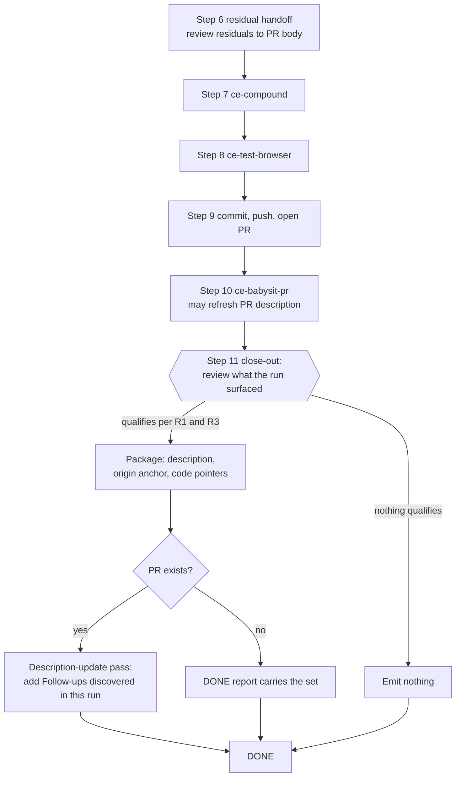

# LFG Follow-Up Detection and Context Capture - Plan

## Goal Capsule

- **Objective:** A developer who hands work to `/lfg` gets the out-of-scope problems the run ran into — a bug it hit, a design gap it skipped, tooling it worked around — handed back with enough context to act on later, instead of losing them when the run ends.
- **Means:** A capture pass in the step-11 close-out, owned by `skills/lfg/references/shipping.md` (KTD1).
- **Authority:** Product behavior on its R-ID; implementation mechanism on its KTD. `AGENTS.md` and `skills/CODING_STANDARDS.md` govern the prose; `.agents/skills/ce-skill-work/references/edit-skill.md` governs the edit procedure.
- **Execution profile:** Prose changes to two skill references (`shipping.md`'s close-out, plus one sentence in `review-followup.md`), plus contract pins and one behavioral eval. No runtime code.
- **Stop conditions:** Stop if the capture pass cannot be stated without growing `skills/lfg/SKILL.md` (KTD1 depends on costing zero body bytes), or if the `ce-skill-work` provenance search shows the close-out already owns a conflicting rule.
- **Who finishes it:** `ce-work` implements; the `/lfg` run that planned this ships it as an open PR.

---

## Product Contract

### Summary

Give `/lfg`'s close-out a pass that reviews what the run surfaced for separable defects and gaps outside the ticket, and packages each one with a short description, an origin anchor, and code pointers. The packaged set reaches the PR body under its own heading, or the DONE report when no PR exists. Nothing is classified, routed, or filed — a sibling ticket owns that. A run that surfaced nothing emits nothing.

### Problem Frame

When `/lfg` implements a ticket, the agent regularly notices things that are real and outside the ticket's scope — the origin proposal's examples are "the bug reporter tool is broken" and "this feature needs a design pass we skipped." That context exists only in the run's own narration, which `skills/lfg/references/task-visibility.md` keeps as chat prose. Once the run ends it is gone, so the problem has to be remembered and re-filed by hand, or it is forgotten.

Nothing in the pipeline covers this today. Five adjacent mechanisms each stop short: `## Unapplied review findings` is diff-scoped by policy, `ce-code-review`'s soft buckets are never read by LFG, `ce-compound` captures reasoning rather than follow-up work, `references/next-work-handoff.md` sources candidates from the plan rather than the run, and `ce-debug`'s `residuals` exist only on the defect route.

### Key Decisions

- KD1. **Detect and package only; never route, classify, or file.** (session-settled: user-directed — chosen over a closing step that also files into intake queues: a sibling classification ticket owns routing and filing.) Independently ratified by `skills/lfg/references/review-followup.md`: "The pipeline files no tickets for these; one ticket per finding, decided by nobody, is how a run of small nits floods a tracker." Governs R10, R11.
- KD2. **A package carries a short description, an origin anchor, and code pointers.** (session-settled: user-directed — chosen over a fuller per-discovery writeup with diagnosis and proposed fix: the package is triage input for someone else, not a solution.) Governs R5, R6, R7.
- KD3. **A run that surfaced nothing out of scope produces no output from this pass.** (session-settled: user-directed — chosen over always emitting a section, placeholder, or "none found" note: the pass must not add noise to every run.) Governs R12.

### Requirements

**Detection**

- R1. At the close-out of a run that changed code, LFG reviews what the run surfaced for a defect or gap in the code, tooling, or product design the run observed and did not change, which is separable work someone else could pick up. Product design is in scope because the Objective promises a design gap the run skipped; R3's floor, not the class, is what keeps the set small.
- R2. Detection draws only on what LFG holds — its own narration across the run and the structured returns of the child skills it invoked. It is not a fresh pass over the repository and not a second review.
- R3. A candidate qualifies only when a reasonable reviewer would open a ticket for it. Below that floor it is not packaged.
- R4. These are not discoveries: a plan's `considered and not built` non-goals; its `Deferred to Follow-Up Work` items; step-6 review residuals; `settled_decision_conflicts` entries; a plan's `Assumptions`; `ce-code-review`'s `residual_risks`, `testing_gaps`, and suppressed or rejected findings; items `ce-simplify-code` deliberately left alone; a flaky check that passed on rerun; a problem local to the machine the run used rather than reproducible for someone else on a clean checkout; and a workaround the contract already documents as an intended path.

**Packaging**

- R5. Each discovery carries a description short enough to scan and specific enough that a reader who was not in the run can tell what is wrong and why it matters.
- R6. Each discovery carries an origin anchor naming the originating ticket or PR and the run. At least one anchor is required, taken in this order of preference: the issue of record or the issue reference the run was invoked with; the PR URL; the review `run_id` and `artifact_path`; the branch and head SHA; the plan path.
- R7. Each discovery carries code pointers as a repo-relative path, or path and line, that resolve in the tree as written.

**Recording**

- R8. When a PR exists, the packaged set reaches that PR's body under a heading of its own, distinct from `## Unapplied review findings`.
- R9. When no PR exists — no remote is configured, or the run held back publication — the DONE report carries the packaged set, and it is never written to a committed file nobody will read.
- R10. The pass does not classify a discovery into a queue, file it to a tracker, deduplicate it against existing records, or open anything.
- R11. The packaged set is framed as input for someone else's triage, not as a verdict that the work is owed.

**Obligation and silence**

- R12. A run that surfaced nothing out of scope emits no heading, no placeholder, and no "none found" line.
- R13. Performing the review is unconditional for a run that reaches the close-out; only the record is conditional on having found something.

### Acceptance Examples

- AE1. **Covers R1, R5, R6, R7, R8.** Given a run whose browser-test step could not start the dev server and worked around it, when the run reaches the close-out with an open PR, then the PR body gains the capture heading with one entry naming the broken script, an origin anchor, and the path to the script.
- AE2. **Covers R12, R13.** Given a run that implemented its plan cleanly and observed nothing outside the ticket, when the run reaches the close-out, then the PR body gains no capture heading and the DONE report says nothing about discoveries.
- AE3. **Covers R4.** Given a plan whose Scope Boundaries recorded two items as `considered and not built`, when the close-out runs, then neither item is packaged as a discovery.
- AE4. **Covers R9.** Given a run in a repo with no remote, when the close-out finds one discovery, then the DONE report carries it and no file is committed for it.
- AE5. **Covers R10.** Given a discovery that looks like a bug, when the close-out packages it, then no tracker ticket is created and no queue is chosen for it.
- AE6. **Covers R1, R3.** Given a run that shipped a feature whose interface it never designed, and noted at the time that the surface needs a design pass it was not doing, when the run reaches the close-out, then that design gap is packaged like any other discovery — it is not excluded for being design rather than code — and a purely cosmetic preference the run happened to voice is not.

### Scope Boundaries

**Deferred to Follow-Up Work**

- Classifying a discovery into the feature, bug, design, or ideation queue, and filing it — the sibling classification ticket under WOR-91.
- Deduplicating a discovery against records that already exist in a target queue.
- The "auto-file follow-ups" toggle from the origin proposal, which governs filing.
- Minimal stubs for intake queues that do not exist yet.

**Considered and not built**

- **Consuming `ce-code-review`'s `pre_existing_findings`.** It computes the same deciding property with `file:line`, quoted evidence, and blame provenance, and would make half of R1 near-deterministic. Not built because the repo contradicts itself about whether `mode:agent` emits it — `skills/ce-code-review/references/modes-and-output.md` lists it in the minimum shape while `skills/ce-code-review/references/subagent-template.md` says the agent JSON leaves pre-existing findings out entirely — and because on `coverage.depth: "lite"` it is `[]` meaning "not assessed", so reading an empty array as "nothing out of scope" would reproduce the skip bug R13 exists to prevent. What would change the call: the contradiction resolved in favour of the envelope, plus a condition that reads `coverage.depth` before trusting the array.
- **A capture point on the stop paths.** Five stop classes never reach the close-out, and a run that stopped because the diagnosis found no safe fix has by construction found something. Not built because a stop already reports why it stopped, so the context is not silently lost, and a second capture mechanism on a path that publishes nothing is machinery the ticket did not ask for. What would change the call: evidence that stop reports are routinely discarded.
- **A JSON schema file for the package.** The field vocabulary is enough for the sibling ticket to consume. A schema file is for subagent fan-in with many producers.
- **A run identifier or run artifact for LFG.** LFG has none today; R6's anchor order reuses ids it already holds rather than inventing one.

**Outside this change**

- Fixing the `pre_existing_findings` contradiction above. That one clears R3's floor and is a discovery of the kind this pass exists to capture; it is recorded rather than fixed.
- Two stale cross-references found while planning (`skills/lfg/references/work-return.md` says "step 8's PR-description context" where shipping is step 9; `skills/lfg/references/task-visibility.md` says "all ten steps" where there are eleven). These are below R3's floor — prose drift, which U1's trigger and U5's noise fixture both grade as not packageable — so they are noted here only to say they were seen and left alone.

### Sources

- Origin proposal: "Automated follow-up ticket creation at the end of /lfg runs" (Notion, Work Board) — problem frame, the record-contents list, and the intake-only framing. Its classification, dedup, toggle, and queue-readiness behaviors belong to the sibling ticket.
- Trackers: WOR-92 (this change), WOR-91 (parent).
- `skills/lfg/references/shipping.md` — step 11's close-out and the step-9 description-update pass that gives the close-out a durable PR sink.
- `skills/lfg/references/review-followup.md` — the existing residual taxonomy, the PR-body section shape, and the no-tickets policy.
- `tests/codex-skill-prompt-budget.test.ts` — the 8,000-byte ratchet that rules out a new numbered step.
- `docs/solutions/skill-design/post-menu-routing-belongs-inline.md` — inline routing 3/3, paraphrasing stub with reference-only detail 0/5, re-inlined 5/5.
- `docs/solutions/skill-design/key-exclusions-on-the-deciding-property-not-an-echoed-word.md` — 0/6 to 6/6 after keying on the deciding property.
- `docs/solutions/skill-design/authoring-auto-invoke-standing-instructions.md` — an agent cannot reliably detect session end but does recognize a named workflow boundary.
- `docs/solutions/skill-design/detector-that-cannot-decide-should-rank-not-assert.md` — a detector's false-positive rate degrades its true-positive signal.
- `docs/solutions/skill-design/strong-models-mask-defensive-skill-fixes.md` — guard both directions; a fix for under-reporting silently causes over-inflation.
- `docs/solutions/skill-design/paired-old-vs-new-injection-skill-evals.md` — prose-presence tests are blind to instruction-interpretation defects.
- `docs/solutions/skill-design/size-driven-skill-restructure.md` — always-loaded stop condition plus a required read at the acting step.

---

## Planning Contract

### Key Technical Decisions

- KTD1. **Capture runs in the step-11 close-out, stated in `skills/lfg/references/shipping.md`.** Three alternatives lost. A new numbered step is unaffordable: `skills/lfg/SKILL.md` measures 7,976 CRLF-adjusted bytes against the enforced 8,000-byte ratchet, 24 bytes of headroom, and `tests/codex-skill-prompt-budget.test.ts` forbids allowlisting a skill past it. Folding a fourth trigger into step 6 measures roughly +146 bytes and `edit-skill.md` additionally asks for about 200 bytes of slack and forbids compressing prose to fit, so it needs 320-650 bytes of relocation in the same diff — and the only donors are always-loaded invariants, one of which `tests/skills/lfg-intake-contract.test.ts` already pins. Step 6 also runs before `ce-test-browser` and `ce-babysit-pr`, so it cannot see the origin proposal's own headline example. The close-out costs zero body bytes, sees the whole run, and runs after the step-10 description refresh rather than before it. Governs R1, R8.
- KTD2. **The close-out's existing DONE gate is the enforcement; no new stop class enters the body.** `skills/lfg/SKILL.md` step 11 already reads "Output `<promise>DONE</promise>` after the close-out in `references/shipping.md`", and `references/shipping.md` is a required read at step 9 governing steps 9 through 11. So the pass sits inside something the run cannot skip without failing its own done condition, and the acting-point read happens before it acts. This is the shape `size-driven-skill-restructure.md` sanctions: an always-loaded gate plus a required read at the acting step.
- KTD3. **The condition is an obligation, never a count.** The close-out states that the review always happens and that the record appears only when the review found something. A count is wrong here because the capture condition has no enumerable trigger set to count: it is one judgment over the whole run, so "none of the N" would be satisfied from nothing. Step 6 is the contrasting case, and the contrast is deliberate — `tests/skills/unified-plan-artifact-contract.test.ts` pins its `Skip only when none of the three exists` precisely because step 6's triggers are finite and named in the body, and the regression that pin records was the skip firing on "Actionable findings: none." while a divergent entry was still undurable. Do not read that pin as sanctioning a count for this pass, and keep the no-count pin scoped to the capture subsection. Governs R13.
- KTD4. **The trigger is keyed on the deciding property, with exactly one subordinated example.** The text being judged is the run's own prose, which uses "out of scope" about itself, so a rule keyed on that phrase gets string-matched against rhetorical asides and misses an unlabeled real discovery. The close-out states the property — a defect or gap the run observed in the code, tooling, or product design it did not change, separable work someone else could pick up — then subordinates one usual failure (tooling the run depended on and worked around) framed as the condition's usual case, with adjudication handed back to the condition. No clause after the no-filing exclusion offers an alternative destination. Governs R1, R3.
- KTD5. **Packaged discoveries get the heading `## Follow-ups discovered in this run`, with plain `-` bullets.** `## Unapplied review findings` is a five-file cross-skill contract and `ce-resolve-pr-feedback` is pinned never to add to, reorder, or create it. Its `- [ ]` checkboxes exist because that skill ticks items its fixes close; a discovery is not closable in this PR, so a checkbox would misstate the affordance. Governs R8.
- KTD6. **The durable sink is a description-update invocation the close-out states for its own case.** `skills/lfg/references/shipping.md` already uses `ce-commit-push-pr mode:pipeline` in description-update mode, but only inside step 9's existing-PR branch, so the close-out cannot simply point at that sentence — on the ordinary path, where step 9 opens the PR itself, it does not apply. The close-out therefore states the same mechanism once for itself, against the PR URL the run already holds. A description edit does not move the head, so the "a push after CI decided leaves an unwatched head" warning does not apply — that warning is about writing files. `skills/ce-commit-push-pr/references/apply-and-handoff.md` lists description-update mode under its do-not-fire set, so it cannot start a second babysit. Because that mode recomposes the whole body and `skills/ce-commit-push-pr/references/pr-description-writing.md` preserves only an enumerated set verbatim — which does not include the review-residual section — the invocation passes the PR's live body through, so a review finding a reviewer closed during step 10 is not restored as open. Governs R8, R9.
- KTD7. **Detection is scoped to what LFG holds, and the blind spot is stated.** Child skills run inline, so LFG normally sees their prose, but `ce-work` with an implementation-engine carrier drives an external model in a detached worktree and returns only structured fields, and `ce-code-review`'s reviewer subagents and `ce-babysit-pr`'s nested `ce-debug` are likewise summarized. The close-out says detection covers LFG's own narration and the structured returns it received, so a reader is not misled into thinking a cross-model run was swept. Governs R2.
- KTD8. **The packaged prose is rendered verbatim, like residual entries.** `skills/lfg/references/shipping.md` is in `tests/skills/ce-noslop-contract.test.ts`'s presentation contracts and already writes the close-out through `ce-noslop` with "the residual entries themselves rendered verbatim". Discovery entries join that verbatim set so the pass's own wording is not re-voiced. Governs R5.
- KTD9. **No new reference file.** The detail lands in `references/shipping.md`, which the run has already loaded at step 9. A new file behind a pointer would add a second load that `post-menu-routing-belongs-inline.md` measured at 0/5 when the detail was reference-only and the pointer paraphrased.
- KTD10. **The pass never commits, pushes, or moves the head.** It edits a description or writes a report, nothing else.

### High-Level Technical Design

The capture pass is one decision path inside the close-out. The shape worth drawing is where it sits relative to the steps that produce its evidence and the two sinks it can reach.

Two properties the diagram carries: the pass runs after every step that can surface a discovery, including the browser-test and CI-watching steps a mid-pipeline pass would miss; and it runs after step 10's optional description refresh, so that refresh cannot drop the section.

### Assumptions

No human was present to settle these, so they are recorded rather than asked.

- The heading `## Follow-ups discovered in this run` is the right name. Any distinct heading satisfies R8; this one was chosen to read as triage input rather than as debt owed.
- "A reasonable reviewer would open a ticket for it" is the materiality floor (R3). The alternative, leaving the floor implicit in "separable work", was rejected because without an operationalized floor a stale step-number cross-reference and a data-loss bug both pass the trigger, and a section full of doc typos trains reviewers to ignore it.
- Stop paths are a non-goal rather than a thin second capture point, on the reasoning in Scope Boundaries.
- The sibling classification ticket will consume the rendered entries plus the field vocabulary (`description`, origin, code pointers), not a schema.
- On the no-PR branch the pass hands the set to the developer at run end and makes it no more durable than that. This is strictly less durable than the repo's nearest analogue rather than parity with it: step 6's no-remote branch files its items through `references/tracker-defer.md` first, and the report carries only the `failed` and `no_sink` residue. KD1 excludes filing here, so the report is the whole record, not the remainder after one. That follows from KD1's no-filing boundary, not from an established repo shape. The durability the Objective describes holds on the PR path; closing the gap on the no-PR branch belongs to the sibling classification ticket.
- Detection depends on the run's own early-step narration still being in the close-out's context eleven steps later, and nothing in the pipeline accumulates it durably — `skills/lfg/references/task-visibility.md` keeps it as chat prose and clears LFG's task surface around every child skill. The same pipeline's step-2 child already treats that context as unreliable, re-opening the plan "because context may have been compacted to a summary that dropped detail". The degradation is one-way: a summarized run under-reports silently rather than over-reporting, so the pass fails toward the silence R12 already sanctions. Accepted because a durable mid-run accumulator is a run artifact LFG does not have, which Scope Boundaries declines to invent.

### Implementation Constraints

- `skills/lfg/SKILL.md` must not grow. Verify its CRLF-adjusted size is unchanged before and after.
- Editing anything under `skills/**` requires invoking the repo-local `ce-skill-work` skill first, per `AGENTS.md`. Its edit mode requires stating the authoring runtime, reading the touched block's goal, searching provenance for anything removed, running its audit table, and producing its completion report.
- The new prose must not name instruction files on the read path — phrase project context as the project's active instructions and conventions already in context.
- The new prose must not contain a literal `docs/<subdir>/` path; `tests/docs-root-literals.test.ts` fails on it.
- The new prose must not reference files outside `skills/lfg/`; `tests/skill-conventions.test.ts` rule 1 fails on it.
- Reference files in this plugin carry no frontmatter; do not add any.
- Do not widen the known drift between `skills/lfg/references/tracker-defer.md` and `skills/ce-work/references/tracker-defer.md`; this change does not touch either.
- Nothing this change writes can stop a later description rewrite from dropping the capture section. Within the run the ordering protects it — the close-out writes it after the CI-watching step — and the live-body pass-through in U2 protects the review-residual section from the capture edit. But an interactive re-run of the PR-babysitting skill afterwards recomposes the body from its own context and reads neither of LFG's files, and the self-containment rule forbids reaching outside `skills/lfg/` to bind it. Making a non-residual section survive that rewrite needs a change in the commit-and-PR skill's description-update path, which this change does not make.

### Sequencing

U1 states the capture contract, U2 adds its sinks, U3 and U4 pin them, U5 proves behavior moved, U6 documents it. U3 through U6 depend on the prose existing.

---

## Implementation Units

### U1. Capture contract in the close-out

- **Goal:** `skills/lfg/references/shipping.md` states, inside step 11's close-out, that the run reviews what it surfaced for out-of-scope discoveries, what qualifies, what does not, and what a package contains.
- **Requirements:** R1, R2, R3, R4, R5, R6, R7, R10, R11, R12, R13. Implements KD1 via R10's boundary, KD2 via R5-R7, KD3 via R12-R13. Cites KTD1, KTD3, KTD4, KTD7, KTD9.
- **Dependencies:** none.
- **Files:** `skills/lfg/references/shipping.md`, `skills/lfg/references/review-followup.md`
- **Approach:**
  1. Add a `### ` subsection under `## Step 11 — close out`, placed after the existing close-out subsections and before the optional next-work offer, so the record is composed before the offer that ends the close-out.
  2. State the obligation first: the close-out always reviews what the run surfaced. Then state the deciding property per KTD4, and subordinate exactly one usual failure as the condition's usual case.
  3. State the evidence scope per KTD7 — LFG's own narration and the structured returns it received — and name the cross-model implementation path as the case detection cannot see.
  4. State the materiality floor per R3, and anchor it with a boundary pair so it is operable rather than nominal: a defect another person could reproduce on a clean checkout, or tooling the run had to work around, clears the floor; prose drift such as a stale cross-reference or a step-number mismatch does not. Then state the non-discoveries per R4 as a short list, keyed on why each is in scope rather than on a label.
  5. Add one sentence to `skills/lfg/references/review-followup.md`, which the run reads at step 3 and which governs steps 3 through 7, directing the run to note an out-of-scope observation in its narration as it occurs so the close-out's review still has it. Without it nothing preserves an observation made at step 3 for a pass that first states itself at step 9, which is the one weakness in reaching the whole run from the close-out.
  6. State the package per KD2: a short description whose test is what it lets a reader do, the origin anchor order from R6 requiring at least one, and code pointers that resolve as written.
  7. State the framing per R11: the set is input for someone else's triage, and the pass does not decide whether a ticket is owed.
  8. State the silence rule per KD3 and KTD3 as an obligation-versus-record distinction, not a count.
- **Patterns to follow:** the step-6 section of `skills/lfg/references/review-followup.md` for how a residual is framed, scoped, and shaped into bullets; `skills/lfg/references/tracker-defer.md`'s capability-not-tool phrasing for naming project context.
- **Execution note:** Invoke the repo-local `ce-skill-work` skill before the first edit and follow its edit mode; its provenance search is what keeps this from re-landing a rule the close-out already reverted. State conditions, not procedures or cases.
- **Test scenarios:**
  - A run that observed broken tooling it worked around yields one packaged entry naming that tooling, with a resolving code pointer.
  - A run that observed nothing outside the ticket yields no entry and no placeholder line.
  - A plan item recorded as `considered and not built` is not packaged.
  - A problem local to the run's own machine, not reproducible on a clean checkout, is not packaged.
  - A stale cross-reference the run noticed is not packaged; a defect another person could reproduce is.
  - A design gap the run observed and skipped is packaged; being design rather than code is not grounds to exclude it.
  - A discovery is packaged without a queue, a ticket, or a dedup check.
  - A run that found nothing emits no heading and no placeholder, and the report says nothing about discoveries.
- **Verification:** `skills/lfg/SKILL.md` is byte-identical to its pre-change state, `bun run test:skill-guards` is green, and the new subsection reads as one condition with one subordinated example rather than a case list.

### U2. Sinks for the packaged set

- **Goal:** The close-out records the packaged set in the PR body under its own heading when a PR exists, and in the DONE report when none does.
- **Requirements:** R8, R9. Cites KTD5, KTD6, KTD8, KTD10.
- **Dependencies:** U1.
- **Files:** `skills/lfg/references/shipping.md`
- **Approach:**
  1. Name the heading from KTD5 and state that it is distinct from the review-residual heading and uses plain bullets because the entries are not closable in this PR.
  2. Route the PR case through a description-update invocation the close-out states for itself per KTD6, against the PR URL the run already holds, rather than pointing at step 9's existing-PR sentence, which does not apply when step 9 opened the PR. State that the invocation edits the description only — no commit, no push, no new babysit.
  3. Require that invocation to read the PR's current body first and pass the live review-residual section through unchanged alongside the capture section, so a finding a reviewer closed during step 10 is not restored as open by the recompose.
  4. Route the no-PR case to the DONE report, covering both no remote and a run that held back publication, and carry the existing prohibition on writing a committed file nobody will read.
  5. Place the discovery entries on the verbatim side of the close-out's `ce-noslop` boundary per KTD8.
  6. State that a discovery appears once even when it was visible earlier in the run.
  7. Name who the record is for and the one move expected of them — the person reviewing the PR, or the developer reading the report when no PR exists — and state that nothing in this PR closes an entry, so the move is to carry it onward or drop it. Without a named reader the section is a notice addressed to nobody.
  8. When the set is non-empty and the run's implementation ran on a cross-model route, carry one line saying that phase's own narration was not visible to this pass, so the record is not read as a sweep of the whole run.
- **Patterns to follow:** the PR-body composition and hand-off shape in `skills/lfg/references/review-followup.md`'s step-6 section; the close-out's existing `ce-noslop` sentence for where verbatim content sits.
- **Test scenarios:**
  - With an open PR, the packaged set reaches the PR body under the new heading and the review-residual heading is untouched.
  - With no remote, the packaged set reaches the DONE report and no file is committed for it.
  - With a remote but no PR, the packaged set still reaches the DONE report.
  - The description-update invocation does not trigger a second CI watch.
  - A discovery visible both earlier in the run and at the close-out appears once.
  - A review-residual bullet ticked closed during step 10 is still ticked after the capture edit.
  - A non-empty set from a cross-model implementation run carries the coverage line; one from an ordinary run does not.
- **Verification:** `bun run test:skill-guards` is green and the close-out's two sinks are each reachable from a single reading of the section.

### U3. Contract pins for the capture prose

- **Goal:** Greppable pins fail on a diff that removes the capture pass, turns its condition into a count, or lets it file.
- **Requirements:** R1, R10, R12, R13.
- **Dependencies:** U1, U2.
- **Files:** `tests/skills/lfg-intake-contract.test.ts`
- **Approach:**
  1. Add one `describe` block for the capture pass to the existing file rather than a new suite, per the repo's preference for tightening an existing guard.
  2. Pin the pass's presence inside the close-out by slicing the step-11 section, so a pin cannot be satisfied by text elsewhere in the file.
  3. Pin ordering by index comparison rather than by step number, so the pins survive renumbering.
  4. Pin the package's three field meanings as a loop, mirroring the existing field-loop pins in the same file.
  5. Add negative pins: no count-shaped skip wording; no tracker, queue, or issue-creation instruction in the capture subsection; no placeholder or "none found" instruction.
  6. Carry a dated provenance comment on each pin saying what regression it catches, as the file's existing pins do.
- **Patterns to follow:** the existing field-loop and `sliceSection` pins in `tests/skills/lfg-intake-contract.test.ts` and `tests/skills/unified-plan-artifact-contract.test.ts`.
- **Execution note:** The presence and ordering pins must go red against the pre-change file; a pin of that kind which passes before the change is asserting a tautology, so drop or re-aim it. The three negative pins cannot go red that way — an assertion that absent text is absent is vacuously true before the change — so prove each one against a regressing variant of the new prose instead.
- **Test scenarios:**
  - Removing the capture subsection fails the presence pin.
  - Rewriting the silence rule as "skip when none of the four exists" fails the count pin.
  - Adding a tracker-filing instruction to the subsection fails the no-filing pin.
  - Moving the subsection out of the close-out fails the slice pin.
  - Renumbering LFG's steps leaves the ordering pin green.
- **Verification:** the presence and ordering pins fail on the pre-change tree and pass after U1 and U2, each negative pin fails against its regressing variant, and `bun test tests/skills/lfg-intake-contract.test.ts` is green.

### U4. Keep the new heading separate from the review-residual contract

- **Goal:** The new heading cannot be absorbed into the review-residual contract that five files share.
- **Requirements:** R8.
- **Dependencies:** U1, U2.
- **Files:** `tests/review-skill-contract.test.ts`
- **Approach:**
  1. Add a negative pin that the new heading is absent from the five-file loop that pins `## Unapplied review findings`, so the two contracts stay separate.
  2. Add a positive pin that `skills/lfg/references/shipping.md` carries both headings distinctly.
- **Patterns to follow:** the five-file heading loop already in `tests/review-skill-contract.test.ts`.
- **Test scenarios:**
  - Adding the new heading to the five-file loop fails the separation pin.
  - Both headings are present and distinct in the close-out's governing file.
- **Verification:** `bun test tests/review-skill-contract.test.ts` is green and the separation pin fails when the heading is added to the shared loop.

### U5. Behavioral eval for the capture pass

- **Goal:** A fresh agent in front of the loaded prose packages a real discovery and stays silent when there is none.
- **Requirements:** R1, R3, R4, R12, R13.
- **Dependencies:** U1, U2.
- **Files:** `tests/skill-eval-cell/` (one cell per fixture, following the directory's existing cell layout)
- **Approach:**
  1. Add a target fixture: a run transcript whose narration contains one genuine out-of-scope discovery plus ordinary narration. Grade on the discovery being packaged with all three package elements.
  2. Add a guardrail fixture: a clean run with nothing out of scope. Grade on no heading, no placeholder, and no entry.
  3. Add a noise fixture: a run whose narration contains a `considered and not built` non-goal, a machine-local environment problem, a documented workaround, and one real-but-below-floor item such as a stale cross-reference the run noticed. Grade on none of them being packaged. The below-floor item is what grades the materiality floor itself, which the other three do not — they are already named exclusions, so a fixture built only from them tests the list and never the judgment.
  4. Inject the on-disk prose at dispatch time rather than invoking the already-loaded skill, because plugin skills cache at session start and an in-session invocation would grade pre-edit content.
  5. Run the paired pre-change and post-change arms on Claude and Codex.
- **Patterns to follow:** the existing cells and fixtures under `tests/skill-eval-cell/`.
- **Execution note:** The guardrail fixture cannot go red before the change — with no capture prose there is nothing to over-fire. Label it a guardrail rather than a delta, and let the target and noise fixtures carry the pre/post comparison.
- **Test scenarios:**
  - Target fixture: the discovery is packaged with a description, an origin anchor, and a code pointer.
  - Guardrail fixture: nothing is emitted.
  - Noise fixture: no non-goal, machine-local problem, documented workaround, or below-floor item is packaged.
  - Pre-change arm: the target fixture produces no package, establishing the delta.
- **Verification:** the target and noise fixtures improve from the pre-change arm to the post-change arm on both harnesses, and the guardrail fixture passes on the post-change arm.

### U6. Document the capture pass in the LFG guide

- **Goal:** `docs/guides/lfg.md` describes the capture pass where it already describes the close-out.
- **Requirements:** R1, R8, R12.
- **Dependencies:** U1, U2.
- **Files:** `docs/guides/lfg.md`
- **Approach:** Extend the guide's existing close-out item with the capture pass, matching the guide's own numbering, which merges several SKILL.md steps rather than mirroring them. State that a run with nothing out of scope shows nothing.
- **Patterns to follow:** the guide's existing numbered solution list and its level of detail.
- **Test expectation: none** — prose-only guide text with no pinned contract. Precedent for updating it in the same PR as a step-structure change is the LFG routing change that shipped with its guide edit.
- **Verification:** the guide's close-out description matches what the close-out now does, and no test pins it.

---

## Verification Contract

| Gate | Command | Applies to |
|---|---|---|
| Dependencies present | `bun install` | prerequisite — this checkout has no `node_modules`, and `tests/skill-conventions.test.ts` imports `js-yaml`, so the skill-guard gate cannot run without it |
| Skill guards | `bun run test:skill-guards` | U1, U2 — the byte ratchet, skill conventions, and contract pins in about a second |
| Body size unchanged | compare the CRLF-adjusted size of `skills/lfg/SKILL.md` before and after | U1, U2 — KTD1 depends on this being zero |
| Targeted contract tests | `bun test tests/skills/lfg-intake-contract.test.ts tests/review-skill-contract.test.ts` | U3, U4 |
| Full suite | `bun run test` | all units, before opening the PR |
| Types | `bun run typecheck` | U3, U4 |
| Behavioral eval | `bun run test:skill-eval-cell`, and `bun run test:skill-eval-pack` for the paired arms | U5 — required because this is a behavior-bearing prose change; a recorded skip reason is the only alternative |

Pins must go red on the regressing variant. A pin that passes against the pre-change tree is not evidence.

---

## Definition of Done

**Global**

- `skills/lfg/SKILL.md` is unchanged, verified by byte comparison.
- The close-out states the capture pass as an obligation with a conditional record, keyed on the deciding property, with no count-shaped skip.
- The packaged set reaches the PR body under its own heading when a PR exists, and the DONE report when none does, and reaches no tracker.
- A run with nothing out of scope emits nothing.
- `bun run test` and `bun run typecheck` pass, and the behavioral eval ran on Claude and Codex or carries a recorded skip reason.
- The `ce-skill-work` completion report exists for each touched block: the goal it now states, what was removed and what provenance showed, what was left short of the standard, what validation ran, and any contract-level decision not made.
- No abandoned or experimental prose from a rejected shape is left in the diff.

**Per unit**

| Unit | Done when |
|---|---|
| U1 | The capture contract reads as one condition with one subordinated example, and the non-discoveries are stated by why they are in scope |
| U2 | Both sinks are reachable from one reading; the description-update mechanism is stated once for the close-out's own case; and a review finding closed during the CI-watching step survives the capture edit |
| U3 | The presence and ordering pins fail on the pre-change tree and pass after, and each negative pin fails against its regressing variant |
| U4 | The new heading is pinned as separate from the review-residual contract |
| U5 | Target and noise fixtures move between arms; the guardrail fixture passes and is labeled a guardrail |
| U6 | The guide's close-out description matches the shipped behavior |
